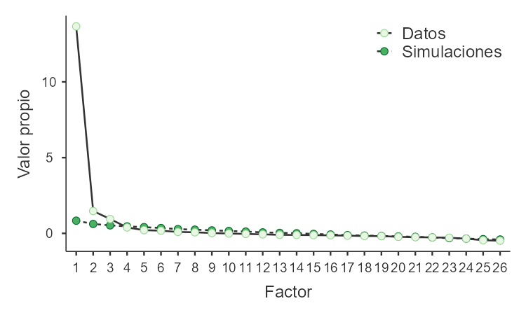

## Qué necesitamos dejar fijado

La expresión «hice un análisis factorial» es insuficiente. Hay que identificar la matriz de asociación, el método de extracción, el número de factores y la rotación. Estas decisiones definen la solución que después interpretaremos [@fabrigar1999].

## Procedimiento A: definir la matriz y la extracción

Para reproducir este archivo se trabaja con correlaciones de **Pearson** sobre los ítems numéricos completados. No se calculó una matriz policórica. El análisis ordinal requeriría volver a las categorías originales y justificar el tratamiento de no respuesta.

En el menú de extracción, selecciona **residuo mínimo, MinRes**. Busca representar la varianza compartida mediante factores comunes. No es un análisis de componentes principales, cuyo propósito es resumir la varianza total.

**Qué queda al terminar la extracción:** una solución de factores comunes calculada con el método declarado. Aún necesitamos decidir cuántos factores interpretar y orientar la solución para facilitar su lectura.

## Procedimiento B: decidir cuántos factores conservar

En la configuración recibida está seleccionado **análisis paralelo**. El procedimiento compara valores propios observados con una referencia obtenida mediante simulaciones del mismo tamaño [@horn1965]. La salida guardada retuvo **tres factores**.

En la interfaz puede aparecer un campo fijo con el valor 1. Ese campo está inactivo cuando se elige análisis paralelo. No describe un AFE de un factor.

{fig-alt="Gráfico original con valores propios de los datos y simulaciones a lo largo de 26 factores."}

El primer factor domina el gráfico. Eso no obliga a conservar solo uno. Tampoco deben imponerse cinco únicamente porque el instrumento se diseñó con cinco bloques. Los valores observados completos se muestran en el [anexo](resultados.qmd#valores-propios).

**Qué hacemos al terminar la retención:** tomamos tres factores como solución de trabajo para esta reproducción y guardamos la justificación. No se ha demostrado todavía que esa solución sea definitiva.

## Procedimiento C: elegir la rotación

Selecciona **Promax**. Es una rotación oblicua, que permite que los factores estén correlacionados. Solicita también las correlaciones factoriales y muestra todas las cargas. Ocultar las inferiores a .20 cambia la presentación, no el modelo [@selker-efa].

**Qué queda al terminar la rotación:** una matriz de patrón que permite examinar la contribución de cada factor, junto con una matriz de correlaciones entre factores. Ahora sí podemos leer dónde se ubica cada pregunta.

## La especificación que debes guardar

| Decisión | Configuración de este caso |
| --- | --- |
| Variables | i01–i26, sin sumas ni medias añadidas |
| Matriz | Pearson sobre la base completada |
| Extracción | MinRes |
| Retención original | Análisis paralelo; tres factores |
| Rotación | Promax |
| Presentación recomendada | Cargas completas, unicidades, correlaciones y ajuste |

Para completar las tablas se reprodujo esta solución en R 4.4.3 [@rcore2025], con psych 2.5.3 y tres factores fijados [@revelle2025]. No se volvió a ejecutar el análisis paralelo. Las cifras visibles coinciden con las guardadas a cuatro decimales.

## Al terminar este paso {.cierre}

**Qué guardas.** Una especificación completa del análisis y una matriz de cargas de tres factores.

**Cómo lo interpretas.** Tres es la solución que vamos a interpretar en esta reproducción; no un número impuesto por el nombre de los bloques.

**Qué haces ahora.** Guarda la copia y las opciones. Muestra las cargas completas antes de decidir la pertenencia de las preguntas.

**Siguiente paso.** Examina cada ítem en [Cargas y decisiones](05-decidir-items.qmd).

**Así queda anotado en este caso:**

> Se interpretó una solución de tres factores, con matriz de Pearson, extracción MinRes y rotación Promax. La retención proviene del análisis paralelo guardado.
