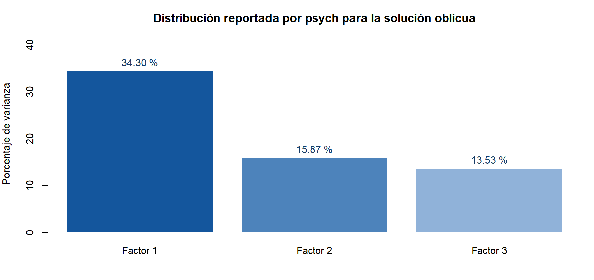

## La pregunta que falta responder

KMO y Bartlett permitieron entrar al AFE. Ahora preguntamos si los tres factores representan adecuadamente las relaciones observadas y si su interpretación es coherente. Una matriz factorizable puede dar lugar a una solución que todavía necesita revisión.

## Procedimiento A: examinar las correlaciones factoriales

| Relación | Correlación |
| --- | --- |
| F1–F2 | 0.6658 |
| F1–F3 | 0.7377 |
| F2–F3 | 0.6355 |

Las tres relaciones son positivas. F1–F3 es la mayor. Permitir correlaciones mediante Promax tiene sentido en esta solución. Las asociaciones no demuestran influencia causal y tampoco ordenan fusionar las dimensiones.

**Al terminar esta revisión:** guardamos la matriz Φ y evitamos interpretar los factores como independientes. Se conserva abierta la distinción entre intención, uso y condiciones del entorno.

## Procedimiento B: describir la varianza representada

| Factor | SC de cargas | % de varianza | % acumulado |
| --- | --- | --- | --- |
| F1 | 8.9190 | 34.30 | 34.30 |
| F2 | 4.1259 | 15.87 | 50.17 |
| F3 | 3.5171 | 13.53 | 63.70 |

{fig-alt="Porcentajes de varianza reportados por psych: 34.30, 15.87 y 13.53 por ciento."}

La solución representa **63.70 % de la varianza** según el resumen de psych. Al estar los factores correlacionados, no se interpretan esos porcentajes como fuentes independientes. Tampoco significan «63.70 % de validez».

**Al terminar esta revisión:** informamos el porcentaje como descripción del modelo. No lo usamos como certificado de aceptación.

## Procedimiento C: integrar los índices de ajuste

| Índice | Resultado | Cómo afecta la decisión |
| --- | --- | --- |
| χ² del modelo | 731.71, gl = 250, p < .001 | El ajuste exacto es rechazado. No es la prueba de Bartlett. |
| RMSEA | 0.0847 | La aproximación presenta discrepancia que merece revisión. |
| IC del 90 % del RMSEA | [0.0778, 0.0921] | Acompaña la incertidumbre del índice. |
| TLI | 0.8925 | No respalda aceptar la solución únicamente por sus coeficientes de confiabilidad. |
| RMSR | 0.0346 | Los residuos son pequeños en promedio; eso puede ocultar pares problemáticos. |
| RMSR corregido | 0.0394 | Versión corregida que informa psych. |
| BIC | -666.03 | Sirve para comparar modelos estimados de modo comparable, no para juzgarlo por su signo. |

No aplicamos un único corte como regla universal. Integramos el contenido, las cargas cruzadas y el conjunto de índices [@ferrando2022]. RMSEA = .0847 y TLI = .8925 son razones para seguir revisando la solución. Un alfa de .9632 y un RMSR de .0346 no cancelan esas observaciones.

Estos índices se calcularon de forma convencional en la base completada. No incorporan corrección robusta ordinal ni la incertidumbre de repetir la imputación.

## Qué se haría para cerrar la revisión

Primero se recuperan las respuestas originales y se justifica su tratamiento. Después se contrastan soluciones que tengan sentido por contenido y por teoría. Por ejemplo, la separación prevista de intención y uso debe estudiarse; no se da por resuelta por el nombre de los bloques. Una revisión o eliminación se vuelve a estimar y se compara con la solución previa. Las cifras de esas alternativas no se han calculado aquí.

## Al terminar este paso {.cierre}

**Qué guardas.** Las correlaciones factoriales, el resumen de varianza y los índices de ajuste.

**Cómo lo interpretas.** La solución es interpretable como exploración, pero las cargas cruzadas, la preparación y el ajuste impiden tratarla como estructura final confirmada.

**Qué haces ahora.** Conserva los resultados como evidencia exploratoria y documenta las revisiones. No crees subescalas definitivas solo a partir de esta solución.

**Siguiente paso.** Cierra el registro y el plan de puntuación en [Puntuar e informar](07-puntuar-informar.qmd).

**Así queda anotado en este caso:**

> La solución de tres factores se considera de trabajo. No se declara confirmada la estructura ni se fijan nuevas subescalas definitivas con estos resultados.
