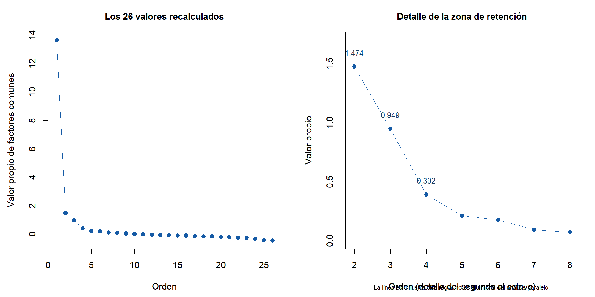
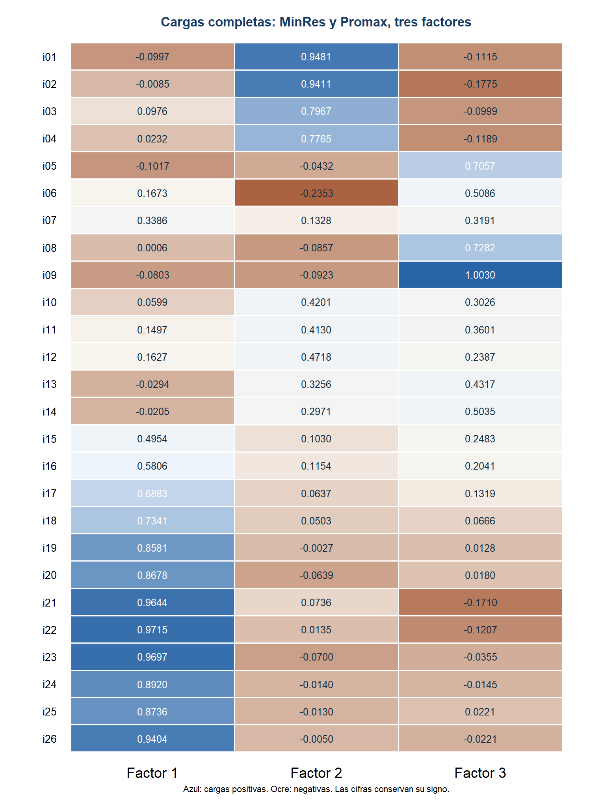

Las cifras se conservan para consultar y contrastar los capítulos. Proceden de la reproducción complementaria con 268 casos y tres factores fijados, salvo el gráfico con simulaciones y el intervalo previo de alfa, que se identifican como registros originales. Los procedimientos se describen en los capítulos 1–7.

## Adecuación de la matriz {#adecuacion-de-la-matriz}

KMO global = .9521. Bartlett: χ²(325) = 6196.77, p < .001.

<table class="table numeric"><thead><tr><th scope="col">Ítem</th><th scope="col">MSA</th></tr></thead><tbody><tr><th scope="row">i01</th><td>0.8969</td></tr><tr><th scope="row">i02</th><td>0.9090</td></tr><tr><th scope="row">i03</th><td>0.9360</td></tr><tr><th scope="row">i04</th><td>0.9420</td></tr><tr><th scope="row">i05</th><td>0.8664</td></tr><tr><th scope="row">i06</th><td>0.9008</td></tr><tr><th scope="row">i07</th><td>0.9443</td></tr><tr><th scope="row">i08</th><td>0.9220</td></tr><tr><th scope="row">i09</th><td>0.8931</td></tr><tr><th scope="row">i10</th><td>0.9543</td></tr><tr><th scope="row">i11</th><td>0.9659</td></tr><tr><th scope="row">i12</th><td>0.9730</td></tr><tr><th scope="row">i13</th><td>0.9379</td></tr><tr><th scope="row">i14</th><td>0.9460</td></tr><tr><th scope="row">i15</th><td>0.9690</td></tr><tr><th scope="row">i16</th><td>0.9671</td></tr><tr><th scope="row">i17</th><td>0.9633</td></tr><tr><th scope="row">i18</th><td>0.9756</td></tr><tr><th scope="row">i19</th><td>0.9740</td></tr><tr><th scope="row">i20</th><td>0.9718</td></tr><tr><th scope="row">i21</th><td>0.9370</td></tr><tr><th scope="row">i22</th><td>0.9628</td></tr><tr><th scope="row">i23</th><td>0.9564</td></tr><tr><th scope="row">i24</th><td>0.9729</td></tr><tr><th scope="row">i25</th><td>0.9757</td></tr><tr><th scope="row">i26</th><td>0.9690</td></tr></tbody></table>

## Valores propios

Son valores del cálculo de factores comunes, distintos de los valores propios de un análisis de componentes principales. El gráfico original conserva la comparación con simulaciones. Los valores numéricos de esas simulaciones no se han reconstruido.

<table class="table numeric"><thead><tr><th scope="col">Orden</th><th scope="col">Valor propio</th></tr></thead><tbody><tr><th scope="row">1</th><td>13.6611</td></tr><tr><th scope="row">2</th><td>1.4742</td></tr><tr><th scope="row">3</th><td>0.9486</td></tr><tr><th scope="row">4</th><td>0.3916</td></tr><tr><th scope="row">5</th><td>0.2124</td></tr><tr><th scope="row">6</th><td>0.1772</td></tr><tr><th scope="row">7</th><td>0.0937</td></tr><tr><th scope="row">8</th><td>0.0715</td></tr><tr><th scope="row">9</th><td>0.0207</td></tr><tr><th scope="row">10</th><td>-0.0090</td></tr><tr><th scope="row">11</th><td>-0.0370</td></tr><tr><th scope="row">12</th><td>-0.0653</td></tr><tr><th scope="row">13</th><td>-0.0968</td></tr><tr><th scope="row">14</th><td>-0.1066</td></tr><tr><th scope="row">15</th><td>-0.1164</td></tr><tr><th scope="row">16</th><td>-0.1293</td></tr><tr><th scope="row">17</th><td>-0.1530</td></tr><tr><th scope="row">18</th><td>-0.1733</td></tr><tr><th scope="row">19</th><td>-0.1802</td></tr><tr><th scope="row">20</th><td>-0.2286</td></tr><tr><th scope="row">21</th><td>-0.2529</td></tr><tr><th scope="row">22</th><td>-0.2652</td></tr><tr><th scope="row">23</th><td>-0.2899</td></tr><tr><th scope="row">24</th><td>-0.3478</td></tr><tr><th scope="row">25</th><td>-0.4539</td></tr><tr><th scope="row">26</th><td>-0.4845</td></tr></tbody></table>

{fig-alt="Valores propios factoriales recalculados con un detalle del segundo al octavo."}

## Diagnósticos de los ítems {#diagnosticos-de-los-items}

Las medias y desviaciones describen la base completada. La correlación ítem–resto compara cada ítem con la suma de los demás. Alfa sin el ítem se compara con el alfa global .9632.

<table class="table numeric"><thead><tr><th scope="col">Ítem</th><th scope="col">Media</th><th scope="col">DE</th><th scope="col">r ítem–resto</th><th scope="col">α sin el ítem</th></tr></thead><tbody><tr><th scope="row">i01</th><td>3.518</td><td>0.999</td><td>0.5697</td><td>0.9628</td></tr><tr><th scope="row">i02</th><td>3.604</td><td>0.971</td><td>0.5935</td><td>0.9626</td></tr><tr><th scope="row">i03</th><td>3.644</td><td>1.059</td><td>0.6459</td><td>0.9622</td></tr><tr><th scope="row">i04</th><td>3.783</td><td>0.912</td><td>0.5428</td><td>0.9630</td></tr><tr><th scope="row">i05</th><td>3.019</td><td>1.153</td><td>0.4612</td><td>0.9640</td></tr><tr><th scope="row">i06</th><td>3.050</td><td>1.042</td><td>0.3921</td><td>0.9643</td></tr><tr><th scope="row">i07</th><td>3.549</td><td>1.037</td><td>0.6957</td><td>0.9618</td></tr><tr><th scope="row">i08</th><td>3.207</td><td>1.260</td><td>0.5433</td><td>0.9635</td></tr><tr><th scope="row">i09</th><td>3.220</td><td>0.959</td><td>0.6965</td><td>0.9618</td></tr><tr><th scope="row">i10</th><td>3.567</td><td>1.206</td><td>0.6496</td><td>0.9623</td></tr><tr><th scope="row">i11</th><td>3.766</td><td>1.055</td><td>0.7806</td><td>0.9611</td></tr><tr><th scope="row">i12</th><td>3.385</td><td>1.193</td><td>0.7365</td><td>0.9615</td></tr><tr><th scope="row">i13</th><td>3.010</td><td>1.104</td><td>0.6061</td><td>0.9626</td></tr><tr><th scope="row">i14</th><td>3.457</td><td>1.036</td><td>0.6524</td><td>0.9622</td></tr><tr><th scope="row">i15</th><td>3.551</td><td>1.080</td><td>0.7597</td><td>0.9612</td></tr><tr><th scope="row">i16</th><td>3.763</td><td>0.985</td><td>0.8095</td><td>0.9609</td></tr><tr><th scope="row">i17</th><td>3.725</td><td>1.072</td><td>0.8054</td><td>0.9608</td></tr><tr><th scope="row">i18</th><td>3.703</td><td>1.086</td><td>0.7800</td><td>0.9611</td></tr><tr><th scope="row">i19</th><td>3.575</td><td>1.026</td><td>0.8052</td><td>0.9609</td></tr><tr><th scope="row">i20</th><td>3.511</td><td>1.027</td><td>0.7700</td><td>0.9612</td></tr><tr><th scope="row">i21</th><td>3.700</td><td>0.990</td><td>0.8066</td><td>0.9609</td></tr><tr><th scope="row">i22</th><td>3.738</td><td>1.030</td><td>0.8070</td><td>0.9609</td></tr><tr><th scope="row">i23</th><td>3.651</td><td>1.011</td><td>0.8113</td><td>0.9609</td></tr><tr><th scope="row">i24</th><td>3.586</td><td>0.994</td><td>0.8052</td><td>0.9609</td></tr><tr><th scope="row">i25</th><td>3.751</td><td>1.048</td><td>0.8191</td><td>0.9608</td></tr><tr><th scope="row">i26</th><td>3.606</td><td>0.952</td><td>0.8506</td><td>0.9606</td></tr></tbody></table>

## Cargas y varianza de los ítems

<table class="table numeric"><thead><tr><th scope="col">Ítem</th><th scope="col">F1</th><th scope="col">F2</th><th scope="col">F3</th><th scope="col">Unicidad</th><th scope="col">Comunalidad</th></tr></thead><tbody><tr><th scope="row">i01</th><td>-0.0997</td><td>0.9481</td><td>-0.1115</td><td>0.3226</td><td>0.6774</td></tr><tr><th scope="row">i02</th><td>-0.0085</td><td>0.9411</td><td>-0.1775</td><td>0.3034</td><td>0.6966</td></tr><tr><th scope="row">i03</th><td>0.0976</td><td>0.7967</td><td>-0.0999</td><td>0.3577</td><td>0.6423</td></tr><tr><th scope="row">i04</th><td>0.0232</td><td>0.7765</td><td>-0.1189</td><td>0.4799</td><td>0.5201</td></tr><tr><th scope="row">i05</th><td>-0.1017</td><td>-0.0432</td><td>0.7057</td><td>0.6285</td><td>0.3715</td></tr><tr><th scope="row">i06</th><td>0.1673</td><td>-0.2353</td><td>0.5086</td><td>0.7369</td><td>0.2631</td></tr><tr><th scope="row">i07</th><td>0.3386</td><td>0.1328</td><td>0.3191</td><td>0.4928</td><td>0.5072</td></tr><tr><th scope="row">i08</th><td>0.0006</td><td>-0.0857</td><td>0.7282</td><td>0.5411</td><td>0.4589</td></tr><tr><th scope="row">i09</th><td>-0.0803</td><td>-0.0923</td><td>1.0030</td><td>0.2057</td><td>0.7943</td></tr><tr><th scope="row">i10</th><td>0.0599</td><td>0.4201</td><td>0.3026</td><td>0.5066</td><td>0.4934</td></tr><tr><th scope="row">i11</th><td>0.1497</td><td>0.4130</td><td>0.3601</td><td>0.3265</td><td>0.6735</td></tr><tr><th scope="row">i12</th><td>0.1627</td><td>0.4718</td><td>0.2387</td><td>0.3913</td><td>0.6087</td></tr><tr><th scope="row">i13</th><td>-0.0294</td><td>0.3256</td><td>0.4317</td><td>0.5595</td><td>0.4405</td></tr><tr><th scope="row">i14</th><td>-0.0205</td><td>0.2971</td><td>0.5035</td><td>0.4911</td><td>0.5089</td></tr><tr><th scope="row">i15</th><td>0.4954</td><td>0.1030</td><td>0.2483</td><td>0.4003</td><td>0.5997</td></tr><tr><th scope="row">i16</th><td>0.5806</td><td>0.1154</td><td>0.2041</td><td>0.3139</td><td>0.6861</td></tr><tr><th scope="row">i17</th><td>0.6883</td><td>0.0637</td><td>0.1319</td><td>0.3017</td><td>0.6983</td></tr><tr><th scope="row">i18</th><td>0.7341</td><td>0.0503</td><td>0.0666</td><td>0.3285</td><td>0.6715</td></tr><tr><th scope="row">i19</th><td>0.8581</td><td>-0.0027</td><td>0.0128</td><td>0.2503</td><td>0.7497</td></tr><tr><th scope="row">i20</th><td>0.8678</td><td>-0.0639</td><td>0.0180</td><td>0.2948</td><td>0.7052</td></tr><tr><th scope="row">i21</th><td>0.9644</td><td>0.0736</td><td>-0.1710</td><td>0.2000</td><td>0.8000</td></tr><tr><th scope="row">i22</th><td>0.9715</td><td>0.0135</td><td>-0.1207</td><td>0.1990</td><td>0.8010</td></tr><tr><th scope="row">i23</th><td>0.9697</td><td>-0.0700</td><td>-0.0355</td><td>0.1916</td><td>0.8084</td></tr><tr><th scope="row">i24</th><td>0.8920</td><td>-0.0140</td><td>-0.0145</td><td>0.2393</td><td>0.7607</td></tr><tr><th scope="row">i25</th><td>0.8736</td><td>-0.0130</td><td>0.0221</td><td>0.2232</td><td>0.7768</td></tr><tr><th scope="row">i26</th><td>0.9404</td><td>-0.0050</td><td>-0.0221</td><td>0.1518</td><td>0.8482</td></tr></tbody></table>

{fig-alt="Las 78 cargas de patrón reproducidas en tres factores, con cifras y signos." .mapa-cargas}

## Correlaciones factoriales

<table class="table numeric"><thead><tr><th scope="col">Factor</th><th scope="col">F1</th><th scope="col">F2</th><th scope="col">F3</th></tr></thead><tbody><tr><th scope="row">F1</th><td>1.0000</td><td>0.6658</td><td>0.7377</td></tr><tr><th scope="row">F2</th><td>0.6658</td><td>1.0000</td><td>0.6355</td></tr><tr><th scope="row">F3</th><td>0.7377</td><td>0.6355</td><td>1.0000</td></tr></tbody></table>

## Resumen de varianza

<table class="table numeric"><thead><tr><th scope="col">Factor</th><th scope="col">SC de cargas</th><th scope="col">% de varianza</th><th scope="col">% acumulado</th></tr></thead><tbody><tr><th scope="row">F1</th><td>8.9190</td><td>34.30</td><td>34.30</td></tr><tr><th scope="row">F2</th><td>4.1259</td><td>15.87</td><td>50.17</td></tr><tr><th scope="row">F3</th><td>3.5171</td><td>13.53</td><td>63.70</td></tr></tbody></table>

## Ajuste

| Índice | Resultado |
| --- | --- |
| χ² del modelo | 731.71 |
| Grados de libertad | 250 |
| p | < .001 |
| RMSEA | 0.0847 |
| IC del 90 % | [0.0778, 0.0921] |
| TLI | 0.8925 |
| RMSR | 0.0346 |
| RMSR corregido | 0.0394 |
| BIC | -666.03 |

## Lectura individual

Las acciones indicadas son decisiones de trabajo. Conservan el carácter exploratorio y no afirman que se haya validado o modificado el instrumento.

### i01: Me resulta claro cómo escribir instrucciones a la IA generativa para realizar actividades de mis cursos.

La formulación de instrucciones se concentra en F2. Las dos cargas secundarias son pequeñas y negativas; no indican que haya que invertir la respuesta. La comunalidad muestra que la solución representa una parte considerable de su variación, mientras que la correlación ítem–resto describe su relación con un total más amplio y multidimensional.

**Decisión de trabajo:** Conservar provisionalmente. Contribuye principalmente a F2. Revisar junto a i02 si ambos aportan contenido diferente.

### i02: Me resulta sencillo formular instrucciones para obtener respuestas útiles de la IA generativa en mis actividades académicas.

La facilidad para formular instrucciones vuelve a definir F2. Su proximidad de contenido con i01 y sus cargas altas aconsejan revisar si ambos cubren aspectos distintos o repiten la misma experiencia. Una carga alta es útil para describir la agrupación, pero no resuelve la redundancia de contenido.

**Decisión de trabajo:** Conservar provisionalmente. Mantener en el estudio de F2 y contrastar su posible redundancia con i01.

### i03: Puedo usar herramientas de IA generativa en mis actividades académicas sin ayuda constante de otras personas.

El uso sin ayuda constante se asocia principalmente con F2. Comparado con i01–i02, conserva una carga algo menor y una contribución secundaria positiva pequeña en F1. Es compatible con la agrupación de facilidad y autonomía percibidas, todavía como interpretación provisional.

**Decisión de trabajo:** Conservar provisionalmente. Mantener como indicador de facilidad y autonomía percibidas en la solución de trabajo.

### i04: Cuando una respuesta de la IA generativa no me sirve para una actividad académica, puedo reformular la consulta con poco esfuerzo.

Reformular una consulta con poco esfuerzo pertenece principalmente a F2. Casi la mitad de su varianza queda como unicidad. El ítem puede captar una destreza más específica que los enunciados sobre claridad o sencillez de las instrucciones; esa diferencia se debe discutir antes de buscar únicamente cargas más altas.

**Decisión de trabajo:** Conservar provisionalmente. Mantener y examinar su contenido específico de reformulación de consultas.

### i05: Mis docentes aceptan el uso de IA generativa como apoyo académico cuando sigo las indicaciones de sus cursos.

La aceptación docente se asocia con F3 y presenta la segunda comunalidad más baja del conjunto. Tiene el menor MSA, aunque sigue siendo favorable para factorización. El alfa global subiría levemente si se retirara; eso no justifica perder automáticamente el contenido de aceptación docente.

**Decisión de trabajo:** Revisar contenido. Contrastar la aceptación docente con la dimensión prevista; h² = .3715. No eliminar por el pequeño aumento de alfa.

### i06: El uso académico de IA generativa por mis compañeros de curso influye en mi interés por usarla.

La influencia de compañeros tiene la mayor unicidad y la menor correlación ítem–resto. Su carga principal está en F3 y existe una contribución negativa visible en F2. La solución común explica alrededor de una cuarta parte de su varianza. Conviene examinar cómo se entiende «influye» y si pertenece al puntaje que se quiere construir.

**Decisión de trabajo:** Revisar representación. Examinar cómo se entiende la influencia de compañeros y si pertenece al puntaje; h² = .2631.

### i07: En mis cursos virtuales, el uso de IA generativa como apoyo académico es habitual entre los estudiantes.

La habitualidad del uso entre estudiantes presenta dos cargas próximas, en F1 y F3. La diferencia entre ellas es .0195. Su correlación con el resto del total es positiva y relativamente alta, pero esa asociación global no le da una pertenencia factorial clara. Es un ejemplo de por qué ambos diagnósticos deben leerse juntos.

**Decisión de trabajo:** Revisar pertenencia. Comparar su sentido con F1 y F3; las cargas .3386 y .3191 no permiten una asignación simple.

### i08: He recibido recomendaciones de docentes o compañeros de mi carrera sobre cómo usar IA generativa para apoyar mi aprendizaje.

Recibir recomendaciones se concentra en F3. Su dispersión es la mayor entre los ítems de esta tabla y la unicidad supera .50. Puede recoger una experiencia de orientación que varía entre estudiantes. Esa heterogeneidad descriptiva no equivale a error de medición por sí sola.

**Decisión de trabajo:** Conservar provisionalmente. Mantener en la agrupación de entorno y orientación; revisar la heterogeneidad de la experiencia que pregunta.

### i09: Percibo que mi universidad acepta el uso académico de IA generativa cuando se siguen sus indicaciones institucionales.

La percepción de aceptación universitaria muestra una carga de patrón de 1.0030 en F3. Al ser una rotación oblicua, esa cifra no es una correlación simple. La unicidad es positiva y la comunalidad es .7943. Hay que revisar la matriz completa y las correlaciones factoriales; la cifra aislada no basta para declarar un caso Heywood.

**Decisión de trabajo:** Conservar con inspección documentada. Contrastar patrón, estructura y unicidad. La carga mayor que uno no exige por sí sola suprimirlo.

### i10: Desde el lugar donde recibo mis clases virtuales, cuento con una conexión estable a internet para usar IA generativa.

La conexión estable a internet participa en F2 y F3. El contenido describe un recurso de acceso, mientras que los ítems más destacados de F2 se refieren a facilidad de uso. Esta mezcla exige decidir si se pretende medir una dimensión reflectiva o construir un índice de condiciones materiales.

**Decisión de trabajo:** Revisar pertenencia. Examinar el recurso de conexión a internet y sus contribuciones a F2 y F3.

### i11: Tengo acceso a un dispositivo que me permite usar IA generativa en mis actividades académicas.

El acceso a un dispositivo también tiene contribuciones en F2 y F3. Su correlación ítem–resto es alta, pero no aparece como un indicador exclusivo de un factor separado de condiciones. Una asociación alta con el total no corrige esa ambigüedad conceptual.

**Decisión de trabajo:** Revisar pertenencia. Examinar si acceso a dispositivo pertenece a un factor reflectivo o a un índice de recursos.

### i12: Tengo acceso a herramientas de IA generativa gratuitas o de un costo que puedo cubrir para mis actividades académicas.

La disponibilidad económica o gratuita de herramientas carga principalmente en F2 y secundariamente en F3. La solución representa cerca del 61 % de su varianza. El resultado sugiere revisar la relación entre acceso y facilidad percibida, sin concluir que ambos sean el mismo concepto.

**Decisión de trabajo:** Conservar provisionalmente. Mantener en la versión de trabajo y discutir su agrupación de acceso con facilidad de uso.

### i13: Tengo acceso a orientación para aprender a usar IA generativa en las actividades de mis cursos.

El acceso a orientación se distribuye entre F3 y F2. Las cargas son suficientemente próximas para que el contenido tenga peso en la decisión de pertenencia. Su ubicación junto a aceptación y recomendaciones es comprensible como hipótesis, pero no confirma una subescala definitiva.

**Decisión de trabajo:** Revisar pertenencia. Contrastar la orientación recibida con F2 y F3 antes de fijar una subescala.

### i14: Las indicaciones de mis docentes sobre el uso permitido de IA generativa en sus cursos son claras para mí.

La claridad de las indicaciones docentes se relaciona sobre todo con F3 y también con F2. Puede reflejar simultáneamente normas del entorno y facilidad para actuar con ellas. No se debe interpretar su carga secundaria como un error que obligue a eliminarlo.

**Decisión de trabajo:** Conservar provisionalmente. Mantener y revisar si su contenido normativo explica la agrupación en F3.

### i15: Tengo intención de seguir usando IA generativa como apoyo académico en mis cursos virtuales.

La intención de seguir usando IA carga principalmente en F1 y secundariamente en F3. El bloque teórico de intención comparte aquí dimensión con el uso declarado. El hallazgo obliga a justificar si conviene distinguir ambos puntajes en vez de dar por confirmada su separación.

**Decisión de trabajo:** Conservar provisionalmente. Mantener y estudiar la distinción conceptual entre intención y uso en F1.

### i16: Es probable que use IA generativa en nuevas actividades de mis cursos cuando las instrucciones permitan su uso.

La probabilidad de uso en nuevas actividades también se concentra en F1, con una contribución secundaria menor en F3. Su correlación ítem–resto es alta. La formulación condicional «cuando las instrucciones permitan su uso» ayuda a discutir por qué puede relacionarse con el entorno normativo.

**Decisión de trabajo:** Conservar provisionalmente. Mantener y conservar la condición de uso permitido al interpretar la respuesta.

### i17: Planeo incorporar la IA generativa como apoyo para aprender los contenidos de mis cursos.

Planear incorporar IA para aprender presenta una carga principal clara en F1. Las contribuciones secundarias son pequeñas. Apoya la agrupación exploratoria de intención y uso, aunque todavía hace falta distinguir un plan de conducta de la conducta efectivamente declarada.

**Decisión de trabajo:** Conservar provisionalmente. Mantener como declaración de planificación; contrastarla con los ítems de uso.

### i18: Tengo intención de usar la IA generativa como apoyo, sin sustituir con sus respuestas el trabajo académico que me corresponde elaborar.

La intención de usar IA sin sustituir el trabajo propio se ubica principalmente en F1. La agrupación estadística no demuestra que ese límite se cumpla en la práctica. El dato es una declaración de intención y debe interpretarse como tal.

**Decisión de trabajo:** Conservar provisionalmente. Mantener como intención declarada; no interpretarlo como conducta verificada.

### i19: Uso IA generativa para apoyar las actividades académicas de mis cursos virtuales.

El uso académico general tiene una carga principal alta en F1 y cargas secundarias cercanas a cero. La comunalidad es aproximadamente .75. Es un indicador destacado de ese factor, sin que la respuesta pruebe una frecuencia objetiva de uso.

**Decisión de trabajo:** Conservar provisionalmente. Mantener como indicador destacado de uso académico declarado en F1.

### i20: Selecciono la herramienta de IA generativa según la actividad académica que debo realizar.

Seleccionar una herramienta según la actividad se concentra en F1. Comparte la dimensión de uso, pero añade el contenido de elección. Su pertenencia común no autoriza a concluir que todas las personas seleccionen de manera adecuada o eficaz.

**Decisión de trabajo:** Conservar provisionalmente. Mantener el contenido de selección de herramientas sin inferir calidad de la elección.

### i21: Uso IA generativa para buscar información relacionada con los contenidos de mis cursos.

Buscar información muestra una carga alta en F1 y una pequeña contribución negativa en F3. La comunalidad se aproxima a .80. Se describe una práctica declarada; el análisis no evalúa la exactitud de la información obtenida.

**Decisión de trabajo:** Conservar provisionalmente. Mantener como búsqueda declarada; el análisis no evalúa la exactitud de lo obtenido.

### i22: Uso IA generativa para obtener explicaciones sobre los contenidos de mis cursos.

Obtener explicaciones vuelve a definir con fuerza F1. Su comunalidad es cercana a .80. La carga alta indica un vínculo con la dimensión de uso declarado, sin demostrar que las explicaciones produzcan mejores aprendizajes.

**Decisión de trabajo:** Conservar provisionalmente. Mantener como búsqueda de explicaciones; no inferir mejoras de aprendizaje.

### i23: Uso IA generativa para sintetizar información que estudio en mis cursos.

Sintetizar información tiene una carga principal alta en F1 y la segunda comunalidad más alta. Esa representación factorial es favorable para describir la agrupación. La calidad de las síntesis requeriría otra evidencia, no contenida en estas respuestas.

**Decisión de trabajo:** Conservar provisionalmente. Mantener como práctica de síntesis; la calidad requiere otra evidencia.

### i24: Uso IA generativa como apoyo para realizar las actividades indicadas por mis docentes en los cursos virtuales.

Realizar actividades indicadas por docentes se asocia principalmente con F1 y tiene contribuciones secundarias muy pequeñas. La respuesta expresa una práctica académica declarada. No permite atribuir autorización a todos los docentes ni verificar cumplimiento de sus instrucciones.

**Decisión de trabajo:** Conservar provisionalmente. Mantener como práctica declarada vinculada a actividades académicas.

### i25: Reviso las respuestas de la IA generativa antes de incorporarlas a los trabajos de mis cursos.

Revisar respuestas de IA se ubica en F1 y tiene el mayor MSA individual. La comunalidad es alta y la correlación ítem–resto también. El resultado agrupa el autocontrol declarado con otras prácticas de uso; no comprueba que esa revisión detecte errores.

**Decisión de trabajo:** Conservar provisionalmente. Mantener el indicador de revisión declarada; no equivale a detección comprobada de errores.

### i26: Declaro que usé IA generativa en mis trabajos cuando las instrucciones de la actividad me lo solicitan.

Declarar el uso cuando se solicita tiene la menor unicidad, la mayor comunalidad y la mayor correlación ítem–resto. Es un indicador destacado de F1. Su condición «cuando se solicita» debe conservarse: la ausencia de solicitud no equivale a falta de transparencia, y el análisis no verifica conductas individuales.

**Decisión de trabajo:** Conservar provisionalmente. Mantener y preservar la condición «cuando se solicita» al interpretar la declaración de uso.

## Archivos agregados

[Descargar resultados de los 26 ítems](descargas/resultados_items.csv) · [Consultar los resultados agregados en JSON](datos/resultados_agregados.json)
